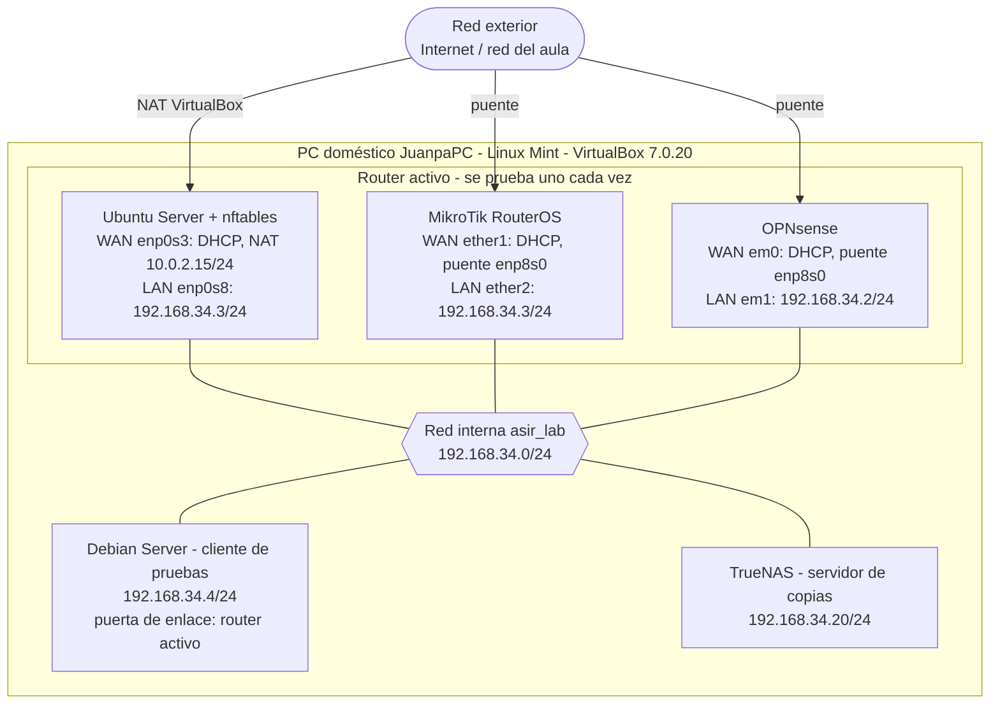

# Esquema de red individual

Esquema del montaje virtual individual, con la configuración de cada interfaz y las direcciones previstas. Se basa en la arquitectura de referencia del aula, adaptada a un único anfitrión (PC doméstico) con VirtualBox.

El número de puesto del aula es el **34**, por lo que la LAN es `192.168.34.0/24`.

Los datos de interfaces y adaptadores se han obtenido con `VBoxManage showvminfo` y `VBoxManage list hostonlyifs` (16/11/2026) y de las pruebas registradas en `evidencies/Comandos.md`.

## 1. Esquema general

Los tres routers (Ubuntu con nftables, MikroTik y OPNsense) se prueban **de uno en uno**: comparten la red interna `asir_lab` y, en algunos casos, la misma IP de LAN, por lo que no se encienden a la vez. El cliente Debian toma como puerta de enlace el router que esté activo.

## 2. Configuración de cada interfaz

| Equipo | Interfaz | Adaptador VirtualBox | Función | Configuración |
|---|---|---|---|---|
| Ubuntu Server | `enp0s3` | NAT | WAN | DHCP: `10.0.2.15/24`, puerta de enlace `10.0.2.2` |
| Ubuntu Server | `enp0s8` | Red interna `asir_lab` | LAN | Estática: `192.168.34.3/24` |
| Ubuntu Server | `enp0s9` | Host-only `vboxnet2` | Gestión | Estática: `192.168.58.3/24` |
| MikroTik | `ether1` | Puente `enp8s0` | WAN | DHCP de la red a la que está conectado el anfitrión |
| MikroTik | `ether2` | Red interna `asir_lab` | LAN | Estática: `192.168.34.3/24` |
| OPNsense | `em0` (WAN) | Puente `enp8s0` | WAN | DHCP de la red a la que está conectado el anfitrión |
| OPNsense | `em1` (LAN) | Red interna `asir_lab` | LAN | Estática: `192.168.34.2/24` |
| OPNsense | `em2` (OPT1) | Host-only `vboxnet0` | Gestión | Estática: `192.168.56.2/24` |
| Debian Server | `enp0s3` | Red interna `asir_lab` | LAN | Estática: `192.168.34.4/24`; puerta de enlace `192.168.34.3` (Ubuntu o MikroTik) o `192.168.34.2` (OPNsense); DNS `8.8.8.8` y `1.1.1.1` |
| TrueNAS | - | Red interna `asir_lab` | LAN | `192.168.34.20/24` |
| TrueNAS | - | Host-only `vboxnet2` | Gestión | `192.168.58.5/24` (según la pestaña del navegador) |

La WAN de MikroTik y OPNsense toma la dirección por DHCP de la red a la que esté conectado el anfitrión. En la red doméstica MikroTik obtuvo `192.168.30.193`; en la red del aula, `172.16.222.221`.

## 3. Red local

- **LAN:** `192.168.34.0/24`, máscara `255.255.255.0`, red interna de VirtualBox `asir_lab`.
- Los routers ocupan el rango bajo (`.2`, `.3`), el servidor de copias `.20` y el cliente de pruebas `.4`, siguiendo la idea del esquema del aula (comunicaciones en `.1-.15`, servidores en `.16-.99` y puestos por DHCP en `.100-.200`).

## 4. Redes de gestión (host-only)

| Red VirtualBox | Direccionamiento | VM conectadas |
|---|---|---|
| `vboxnet0` | `192.168.56.0/24` (anfitrión `.1`) | OPNsense |
| `vboxnet1` | `192.168.57.0/24` (anfitrión `.1`) | TrueNAS, Proxmox N1 |
| `vboxnet2` | `192.168.58.0/24` (anfitrión `.1`) | Ubuntu Server, TrueNAS, clones de recuperación |

Cada VM de gestión se conecta a la red host-only cuyo direccionamiento coincide con su IP de gestión. La gestión de OPNsense (`192.168.56.2`) está en `vboxnet0`.

## 5. Direcciones previstas

Siguiendo el patrón del esquema del aula, adaptado a la LAN `192.168.34.0/24`. El clúster Proxmox se documenta como diseño (ver `00-entorno-pruebas/04-entorn-virtualitzacio.md`, apartado 8).

| Elemento | Dirección prevista | Estado |
|---|---|---|
| Nodo 1 Proxmox VE | `192.168.34.32/24` | Previsto |
| Nodo 2 Proxmox VE | `192.168.34.33/24` | Previsto |
| Nodo 3 Proxmox VE | `192.168.34.34/24` | Previsto |
| VM Windows Server 2025 | `192.168.34.21/24` | Configurada y probada (16/11/2026) |
| VM Debian (servicios) | `192.168.34.22/24` | Configurada y probada (16/11/2026) |
| VM Debian (datos) | `192.168.34.23/24` | Configurada y probada (16/11/2026) |
| Cliente Windows 11 | `192.168.34.100/24` (estática) | Configurado y probado (16/11/2026) |
| Otros puestos de trabajo (clientes) | DHCP, `192.168.34.101-200` | Previsto |

En todos los casos, puerta de enlace en el router activo y DNS configurado.

## 6. Montaje virtual

| Recurso | Valor |
|---|---|
| Anfitrión | PC doméstico, AMD Ryzen 5 3400G, 16 GB de RAM, Linux Mint |
| Hipervisor | VirtualBox 7.0.20 |
| Máquinas del montaje | Ubuntu Server, MikroTik, OPNsense, Debian Server y TrueNAS (más los clones de recuperación y los tres nodos Proxmox creados) |

El inventario completo, con vCPU, RAM y disco de cada VM, está en `00-entorno-pruebas/04-entorn-virtualitzacio.md`.
