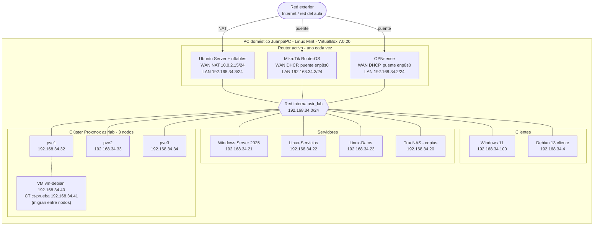

# Esquema de red individual

Montaje virtual individual en VirtualBox, basado en la arquitectura de referencia del aula. Puesto del aula: **34**, LAN `192.168.34.0/24`.

## 1. Esquema general

Los tres routers (Ubuntu con nftables, MikroTik y OPNsense) se prueban de uno en uno: comparten la red interna `asir_lab` y la misma IP en algunos casos. Router activo: MikroTik.

## 2. Configuración de cada interfaz

| Equipo | Interfaz | Adaptador VirtualBox | Función | Configuración |
|---|---|---|---|---|
| Ubuntu Server | `enp0s3` | NAT | WAN | DHCP: `10.0.2.15/24`, puerta de enlace `10.0.2.2` |
| Ubuntu Server | `enp0s8` | Red interna `asir_lab` | LAN | Estática: `192.168.34.3/24` |
| Ubuntu Server | `enp0s9` | Host-only `vboxnet2` | Gestión | Estática: `192.168.58.3/24` |
| MikroTik | `ether1` | Puente `enp8s0` | WAN | DHCP de la red a la que está conectado el anfitrión |
| MikroTik | `ether2` | Red interna `asir_lab` | LAN | Estática: `192.168.34.3/24` |
| OPNsense | `em0` (WAN) | Puente `enp8s0` | WAN | DHCP de la red a la que está conectado el anfitrión |
| OPNsense | `em1` (LAN) | Red interna `asir_lab` | LAN | Estática: `192.168.34.2/24` |
| OPNsense | `em2` (OPT1) | Host-only `vboxnet0` | Gestión | Estática: `192.168.56.2/24` |
| Debian Server | `enp0s3` | Red interna `asir_lab` | LAN | Estática: `192.168.34.4/24`; puerta de enlace `192.168.34.3` (Ubuntu o MikroTik) o `192.168.34.2` (OPNsense); DNS `8.8.8.8` y `1.1.1.1` |
| TrueNAS | - | Red interna `asir_lab` | LAN | `192.168.34.20/24` |
| TrueNAS | `em0` | Host-only `vboxnet1` | Gestión | `192.168.57.3/24` |
| Windows Server 2025 | `Ethernet` | Red interna `asir_lab` | LAN | Estática: `192.168.34.21/24` |
| Windows 11 | `Ethernet` | Red interna `asir_lab` | LAN | Estática: `192.168.34.100/24` |
| Linux-Servicios | - | Red interna `asir_lab` | LAN | Estática: `192.168.34.22/24` |
| Linux-Datos | - | Red interna `asir_lab` | LAN | Estática: `192.168.34.23/24` |
| Nodos Proxmox `pve1`-`pve3` | `vmbr0` | Red interna `asir_lab` (modo promiscuo: permitir todo) | LAN y clúster | Estática: `192.168.34.32/24`, `.33`, `.34` |
| Nodos Proxmox `pve1`-`pve3` | segundo adaptador | Host-only `vboxnet1` | Gestión web | `192.168.57.32/24`, `.33`, `.34` |

La WAN de MikroTik y OPNsense toma la dirección por DHCP de la red a la que esté conectado el anfitrión. En la red doméstica MikroTik obtuvo `192.168.30.193`; en la red del aula, `172.16.222.221`.

## 3. Direccionamiento de la LAN

| Rango | Uso | Equipos |
|---|---|---|
| `.2` - `.4` | Comunicaciones y cliente de pruebas | OPNsense `.2`, router MikroTik/Ubuntu `.3`, Debian cliente `.4` |
| `.20` - `.23` | Servidores | TrueNAS `.20`, Windows Server 2025 `.21`, Linux-Servicios `.22`, Linux-Datos `.23` |
| `.32` - `.34` | Nodos Proxmox | `pve1`, `pve2`, `pve3` |
| `.40` - `.41` | Invitados de Proxmox | `vm-debian` `.40`, `ct-prueba` `.41` |
| `.100` | Cliente | Windows 11 (estática) |
| `.101` - `.200` | Reservado para otros puestos por DHCP | Sin usar |

Máscara `255.255.255.0`. Los clientes y servidores usan como puerta de enlace el router activo.

## 4. Redes de gestión (host-only)

| Red VirtualBox | Direccionamiento | VM conectadas |
|---|---|---|
| `vboxnet0` | `192.168.56.0/24` (anfitrión `.1`) | OPNsense |
| `vboxnet1` | `192.168.57.0/24` (anfitrión `.1`) | TrueNAS, nodos Proxmox (`.57.32` a `.57.34`) |
| `vboxnet2` | `192.168.58.0/24` (anfitrión `.1`) | Ubuntu Server, TrueNAS, clones de recuperación |

## 5. Montaje virtual

| Recurso | Valor |
|---|---|
| Anfitrión | PC doméstico, AMD Ryzen 5 3400G, 16 GB de RAM, Linux Mint |
| Hipervisor | VirtualBox 7.0.20 |
| Máquinas | 14 VM del grupo `/ISOFHW`; inventario con vCPU, RAM y disco en [`../../00-entorno-pruebas/04-entorn-virtualitzacio.md`](../../00-entorno-pruebas/04-entorn-virtualitzacio.md) |
