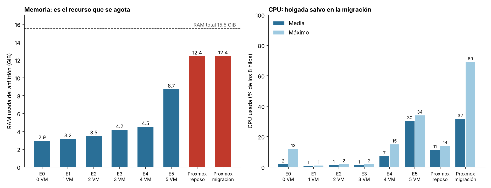

# Informe de rendimiento del laboratorio (tarea 7)

Medidas del 17/11/2026 en el PC doméstico, que es el equipo más limitado de los dos (el portátil tiene 32 GB). El objetivo es saber qué recurso se agota, cuántas máquinas virtuales caben a la vez sin bloquear el anfitrión y qué combinaciones de VM se recomiendan.

## 1. Equipo medido

| Elemento | Valor |
|---|---|
| Procesador | AMD Ryzen 5 3400G: 4 núcleos, 8 hilos |
| Memoria | 16 GB (15 914 MiB visibles, 15,5 GiB) |
| Almacenamiento | SanDisk Portable SSD de 931,5 GB por USB 3.2: contiene el sistema, `/home` y todos los discos de las VM |
| Red | Tarjeta física `enp8s0`, usada como adaptador puente (WAN) de los routers |
| Sistema | Linux Mint 22.3 con VirtualBox 7.0.20 |
| Carga fija del anfitrión | Mint, Firefox y una terminal abiertos en todas las etapas: unos 3,0 GB de RAM |

## 2. Método

El script [`scripts/medir.sh`](scripts/medir.sh) mide el anfitrión durante una etapa (120 s o 60 s, una muestra de `vmstat` cada 5 s) y guarda CPU, memoria, swap, espera de disco, escritura en disco (`vmstat`) y, al final, el tráfico de la tarjeta de red y el uso del disco `sda`. Además toma una instantánea con `free -m` y las VM encendidas (`datos/instantaneas.txt`). El script [`scripts/escalado.sh`](scripts/escalado.sh) arranca las VM del proyecto de una en una, espera a que se asienten (60 a 240 s según el sistema) y mide tras cada una. Se detiene si la memoria disponible no deja 1,5 GB de margen sobre la RAM de la siguiente VM. Con [`scripts/informe.py`](scripts/informe.py) se genera la tabla limpia y la gráfica.

Solo cuentan las 14 VM del grupo `/ISOFHW` de VirtualBox; las 5 de otras actividades no se tocan.

## 3. Datos válidos

El `07-rendimiento-diagnostico/datos/host.csv` completo está en `datos/`. En la ejecución de `07-rendimiento-diagnostico/scripts/escalado.sh` había cuatro VM ya encendidas (`Debian Server`, `MikroTik`, `Linux-Servicios` y `Linux-Datos`), por lo que una parte de las filas no corresponde a lo que indica el nombre de su etapa (VirtualBox rechazó arrancar las que ya estaban encendidas). Para el informe se usan solo las ventanas de tiempo en las que `07-rendimiento-diagnostico/datos/instantaneas.txt` confirma que las VM encendidas coinciden con la etapa. Las demás filas se conservan en `datos/` como medidas repetidas del estado de cuatro VM.

| Etapa | Máquinas encendidas | Muestras (cada 5 s) |
|---|---|---:|
| E0 | Ninguna | 36 |
| E1 | MikroTik | 12 |
| E2 | E1 + Linux-Servicios | 12 |
| E3 | E2 + Linux-Datos | 12 |
| E4 | E3 + Debian Server | 12 |
| E5 | E4 + Windows Server 2025 | 12 |
| Proxmox, reposo | MikroTik + `Proxmox N1`, `N2` y `N3` (con un contenedor y una VM dentro) | 24 |
| Proxmox, migración | Lo anterior, migrando la VM de `pve3` a `pve1` | 24 |

## 4. Resultados

| Etapa | RAM usada | RAM disponible | CPU media / máxima | Escritura en disco media / máxima | Swap usado |
|---|---:|---:|---:|---:|---:|
| E0 sin VM | 2,9 GiB | 12,6 GiB | 1,9 % / 12 % | 0,1 / 2,0 MB/s | 381 MB |
| E1 + MikroTik | 3,2 GiB | 12,4 GiB | 0,8 % / 1 % | 0,02 / 0,2 MB/s | 381 MB |
| E2 + Linux-Servicios | 3,5 GiB | 12,1 GiB | 1,2 % / 2 % | 0,02 / 0,1 MB/s | 380 MB |
| E3 + Linux-Datos | 4,2 GiB | 11,4 GiB | 1,2 % / 2 % | 0,07 / 0,6 MB/s | 380 MB |
| E4 + Debian Server | 4,5 GiB | 11,0 GiB | 7,2 % / 15 % | 0,15 / 0,7 MB/s | 376 MB |
| E5 + Windows Server 2025 | 8,7 GiB | 6,8 GiB | 30,2 % / 34 % | 46,9 / 173,7 MB/s | 376 MB |
| Proxmox, reposo | 12,4 GiB | 3,1 GiB | 11,2 % / 14 % | 0,4 / 1,9 MB/s | 490 MB |
| Proxmox, migración | 12,4 GiB | 3,1 GiB | 31,7 % / 69 % | 16,5 / 164,9 MB/s | 490 MB |

Los datos de cada etapa están en `datos/resumen-etapas.csv`. La red y el uso de disco que mide `07-rendimiento-diagnostico/datos/resumen.csv` (la tarjeta `enp8s0` y el disco `sda`) dan: 4,0 MB/s de entrada y 17,2 % de uso del disco con Windows Server (E5), 0,6 MB/s de entrada y 6,1 % de uso del disco durante la migración, y menos de 2 MB/s y 0,5 % en las demás etapas.

Coste de RAM de cada VM medido en el anfitrión (diferencia de RAM usada entre etapas consecutivas) frente a la RAM asignada en VirtualBox:

| VM | RAM asignada | Aumento medido |
|---|---:|---:|
| MikroTik | 0,5 GB | 0,2 GB |
| Linux-Servicios | 2 GB | 0,3 GB |
| Linux-Datos | 2 GB | 0,7 GB |
| Debian Server | 2 GB | 0,3 GB |
| Windows Server 2025 | 4 GB | 4,2 GB |

Las VM de Linux gastan mucho menos de lo que tienen asignado, porque solo ocupan la memoria que usan sus procesos. Windows Server ocupa prácticamente toda la que se le asigna.

## 5. Recursos saturados

- **Memoria: es el recurso que se agota.** Con el clúster Proxmox (tres nodos de 3 GB y las máquinas de dentro) el anfitrión usa 12,4 GiB de 15,5 GiB. La memoria libre cae a 186-298 MB y el uso de swap sube de 376-381 MB a 490 MB. El uso de swap pasa de 376-381 MB a 490 MB, señal de que el sistema ya descarga memoria a disco. Es el límite del equipo.
- **CPU: con holgura.** Una media de 30 % con Windows Server y picos del 69 % en la migración, sobre 8 hilos. La espera de disco (`wa`) no pasa del 2 %.
- **Disco: picos altos, pero sin saturación sostenida.** Las escrituras llegan a 165-174 MB/s cuando Windows Server arranca y durante la migración (la copia del disco de 4 GB), y vuelven a valores mínimos después. El uso del disco (`util`) fue del 17,2 % y del 6,1 % en esas etapas. Como todo el laboratorio vive en un SSD por USB, esos picos están cerca del rendimiento esperable de ese dispositivo.
- **Red: no es limitante.** El máximo medido en la tarjeta física fue de 4 MB/s de entrada (Windows Server, con Windows Update y telemetría en su primer arranque). El tráfico entre VM por la red interna `asir_lab` no pasa por la tarjeta física, así que esta medida solo refleja la salida a Internet.

## 6. Cuántas máquinas caben sin bloquear el equipo

El criterio es que quede al menos 1,5 GB de memoria disponible y que el swap no crezca de forma sostenida.

| Combinación | Resultado medido | ¿Cabe? |
|---|---|---|
| MikroTik + Linux-Servicios + Linux-Datos + Debian Server | 4,5 GiB usados, 11,0 GiB disponibles | Sí, con mucho margen |
| Las cuatro anteriores + Windows Server 2025 (5 VM) | 8,7 GiB usados, 6,8 GiB disponibles, CPU 30 % | Sí |
| Anterior + TrueNAS (8 GB asignados) | `07-rendimiento-diagnostico/scripts/escalado.sh` lo rechazó: quedaban 6,8 GiB disponibles y se exigen 9,7 | No sin ajustar |
| Clúster Proxmox (MikroTik + 3 nodos, con contenedor y VM dentro) | 12,4 GiB usados, 3,1 GiB disponibles, swap 490 MB | Sí, pero en el límite: no cabe nada más |

**Conclusión: en este PC caben 5 VM del proyecto a la vez (router, Debian, los dos servidores Linux y Windows Server) con 6,8 GiB de margen, o bien el router y los tres nodos Proxmox sin nada más.** No caben ambos a la vez. TrueNAS (8 GB) no se mide porque junto a Windows Server no cabe.

Estimaciones, no medidas: una VM Windows 11 más (4 GB asignados, comportamiento parecido a Windows Server) dejaría unos 2,5 GiB disponibles, el límite del criterio. En el portátil de 32 GB, con el doble de memoria, caben todas esas combinaciones a la vez salvo el conjunto completo del laboratorio, que asignaría unos 44 GB.

## 7. Reparto recomendado

| Escenario | Máquinas encendidas | RAM usada (estimada o medida) |
|---|---|---|
| Servicios de infraestructura | MikroTik, Linux-Servicios, Linux-Datos, Debian Server (cliente) | 4,5 GiB (medido) |
| Servicios con Windows | Lo anterior + Windows Server 2025 | 8,7 GiB (medido) |
| Copias de seguridad | MikroTik, Debian Server y TrueNAS, y nada más | unos 11 GiB (estimado) |
| Clúster Proxmox | MikroTik y `Proxmox N1`, `N2`, `N3` | 12,4 GiB (medido) |
| Recuperación ante fallo | El router clonado (`...-RECUPERACION`) en lugar del original, más el cliente | según el router |

Las VM no necesarias (`OPNsense`, `Ubuntu Server` como router, los clones de recuperación) se encienden solo para su prueba.

## 8. Limitaciones

- Una sola ejecución de cada etapa, con 12 muestras de 5 s (60 s). Las medidas de memoria son estables entre repeticiones, pero la CPU y el disco varían entre ejecuciones.
- TrueNAS no se midió porque no cabe junto a Windows Server según el criterio.
- Con Windows Server la medida se tomó unos 4 minutos después de arrancar, cuando aún había actividad de arranque y actualizaciones: sus picos de disco y red son más altos que en régimen estable.
- El Proxmox corre dentro de VirtualBox, con doble virtualización, por lo que su coste de CPU y memoria es mayor que en un servidor real.

## 9. Ficheros

| Fichero | Contenido |
|---|---|
| `datos/host.csv` | Muestra de `vmstat` cada 5 s de todas las etapas |
| `datos/resumen.csv` | Red y disco por etapa; los dos primeros registros, de la etapa Proxmox, tienen coma decimal por el idioma del sistema (`0,6` es 0,6) y las siguientes llevan punto |
| `datos/instantaneas.txt` | `free -m` y VM encendidas en cada etapa |
| `datos/resumen-etapas.csv` | Tabla limpia, solo con las ventanas válidas |
| `datos/escalado.log`, `datos/limite.txt` | Salida del script de etapas y límite alcanzado |
| `evidencies/2026-11-17-rendimiento-etapas.png` | Gráfica de memoria y CPU |
